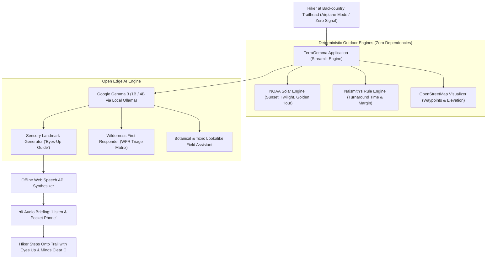

# 🌲 TerraGemma

> **An offline-first backcountry expedition companion powered by Google Gemma 3.**  
> *Built for Hacktoberfest 2026: Week 1 — Theme: "Touch Grass"*

[-green.svg)](https://ai.google.dev/gemma)
[](https://opensource.org/licenses/MIT)
[-blue.svg)](https://ollama.com)
[](#why-open-innovation-matters)

<p align="center">
  
</p>

---

## 🌿 The Philosophy: Make the Screen the Shortest Part of the Hike

Modern hiking and outdoor apps have fallen into the same trap as social media: they encourage you to stare down at a glowing blue glass screen while walking through ancient forests and alpine peaks. Turn-by-turn navigation alerts buzz on your wrist every 30 seconds. Hikers miss the rustle of leaves, the scent of damp hemlock needles, and the warning shift of mountain winds.

**TerraGemma is designed around a radical outdoor principle: Eyes Up, Screen Down.**

Instead of keeping you glued to an interactive feed:
1. It computes an astronomical sunset and a strict **Naismith Turnaround Deadline**.
2. It prompts local **Gemma 3** to synthesize **3–4 physical sensory landmark anchors** (sound of creek rapids, distinctive stone cairns, wind direction shifts).
3. It plays a concise **Audio Briefing directly in your ear** via offline browser speech synthesis.
4. **You put your phone in your pocket, hike hands-free, and touch grass.**

If an emergency or injury strikes miles past the trailhead where cellular service drops to zero, TerraGemma acts as an autonomous **Wilderness First Responder (WFR)** triage guide running 100% locally on your machine.

---

## ✨ Core Features

### 1. ⏱️ NOAA Solar Engine & Naismith's Turnaround Rule
- **Astronomical Precision:** Calculates sunrise, sunset, golden hour, and civil dusk using exact NOAA solar algorithms with zero external dependencies.
- **Naismith's Rule with Elevation Penalties:** Incorporates base moving pace plus 1 hour per 2,000 ft of vertical ascent to prevent hikers from being stranded in the dark.
- **Color-Coded Daylight Safety Margin:** Instantly flags whether your hike duration provides a safe daylight buffer (🟢 Safe), a tight margin (🟡 Caution), or hazardous dusk exposure (🔴 Danger).

### 2. 🎧 "Eyes-Up, Screen-Down" Sensory Navigation Guide
- Gemma 3 translates complex trail maps into **memorable physical cues**:
  - *Sound Anchors:* Water rapids, bird vocalization zones, canyon echoes.
  - *Scent Anchors:* Ponderosa pine vanilla notes, marshland cedar groves.
  - *Visual Checkpoints:* Granite monoliths, trail splits marked by ancient birches.
- Eliminates compulsive phone checking so your senses remain tuned to your environment.

### 3. 🔊 Offline Audio Briefing ("Listen & Pocket Phone")
- Integrated with the browser's native **Web Speech API (`window.speechSynthesis`)**.
- Requires **zero cloud speech APIs** and zero network downloads.
- Reads your turnaround time and sensory cues aloud at the trailhead so you can pocket your phone before taking your first step.

### 4. 🚨 Offline Wilderness First Responder (WFR) Triage
- Backcountry emergency decision support when 911 is out of cellular reach:
  - **Cold Exposure & Hypothermia:** Shivering stages, the "Hypo-Wrap" method, warming contraindications.
  - **Heat Illness:** Discerning Heat Exhaustion vs. life-threatening Heat Stroke.
  - **Venomous Snakebites:** Pit viper protocols, immobilisation, dispelling harmful myths (no tourniquets, no suction).
  - **Allergies & Stings:** Scrape removal, airway monitoring, immediate EpiPen guidance.
  - **Musculoskeletal:** Wilderness splinting, Ottawa ankle rules.
  - **Lost on Trail:** S.T.O.P. Protocol (Stop, Think, Observe, Plan) and international 3-blast whistle signaling.
- Dynamic symptom evaluation powered by Gemma 3 to assess unique situational emergencies.

### 5. 🌿 Field Flora, Fauna & Toxic Lookalike Protection
- Comprehensive side-by-side identification of lethal and severe lookalikes:
  - *Poison Ivy vs. Virginia Creeper* (3 leaflets vs. 5 leaflets, aerial root vines).
  - *Queen Anne's Lace vs. Deadly Poison Hemlock* (hairy green stems vs. smooth purple-mottled stems).
  - *Wild Blackberry vs. Toxic Baneberry / Doll's Eyes*.
  - *Black Bear vs. Grizzly Bear* (shoulder humps, facial profiles, charge responses).
- **Mindful "Touch Grass" Missions:** Structured observational tasks that turn nature walks into sensory restoration.

### 6. 🗺️ Interactive Open Geospatial Mapping
- OpenStreetMap and Folium integration rendering trailheads, water sources, summits, shelters, and turnaround waypoints with zero proprietary map subscriptions.

---

## 🏛️ System Architecture



---

## 💡 Why Does Open Innovation Matter?

In a city, an AI assistant relying on a closed cloud API (OpenAI, Anthropic, Gemini Cloud API) works fine. **In the backcountry, a closed API is 100% dead.**

### 1. Zero-Connectivity Resilience
The moment you hike past the trailhead in a national park or remote valley, cell signal drops to 0 bars. Closed APIs become infinite loading spinners. Open-weight models like **Gemma 3** run completely offline on your device's CPU or edge silicon. You carry a world-class naturalist and wilderness first responder with you without a single cell tower in sight.

### 2. Radical Location & Health Privacy
Commercial outdoor apps routinely log your exact GPS coordinates, movement velocity, and medical health profiles, transmitting them back to ad trackers and corporate data brokers. TerraGemma executes 100% on-device: **your coordinates, trail notes, and emergency symptoms never touch an external server.**

### 3. Zero Running Cost & Unlimited Wilderness Use
Closed APIs charge meter fees per thousand tokens and enforce rate limits. On a multi-day backpacking trek, an open-weight model costs **$0.00**, will never hit an API rate limit, and operates completely indefinitely.

### 4. Efficient Quantized Edge Footprint
Google's **Gemma 3 (1B)** requires under 1 GB of memory. It runs on consumer laptops and edge hardware in hundreds of milliseconds without draining critical battery reserves needed for survival navigation.

---

## 🏆 Prize Category: Best Use of Gemma ($200 USD)

TerraGemma is built natively for Google's open-weight **Gemma 3** architecture:
- **`gemma3:1b` (Primary Edge Model):** Ultra-fast inference (~500ms on CPU) tailored for real-time sensory navigation briefings, pack checklists, and rapid outdoor triage.
- **`gemma3:4b` (Analytical Model):** Deeper contextual reasoning for complex wilderness dilemmas, botanical nuance, and evacuation decisions.
- **Ollama Edge Runtime:** Leverages Ollama's local inference daemon with `keep_alive: 60m` to ensure instant responsiveness without re-loading model weights between trail stops.

---

## 🚀 Quickstart & Installation

### Prerequisites
- Python 3.10+
- [Ollama](https://ollama.com) (for local Gemma 3 inference)

### 1. Pull Gemma 3 Locally
```bash
ollama run gemma3:1b
# Optional for deeper analysis:
ollama pull gemma3:4b
```

### 2. Clone the Repository & Install Dependencies
```bash
git clone https://github.com/shivamgravity/terragemma.git
cd terragemma

pip install -r requirements.txt
```

### 3. Launch TerraGemma
```bash
streamlit run app.py
```

Open your browser to `http://localhost:8501`. If Ollama is running, TerraGemma will automatically detect `gemma3:1b`. If Ollama is paused, TerraGemma's built-in resilient heuristic engine will seamlessly keep all features operational.

---

## 📜 License
This project is open-source and licensed under the [MIT License](LICENSE).
